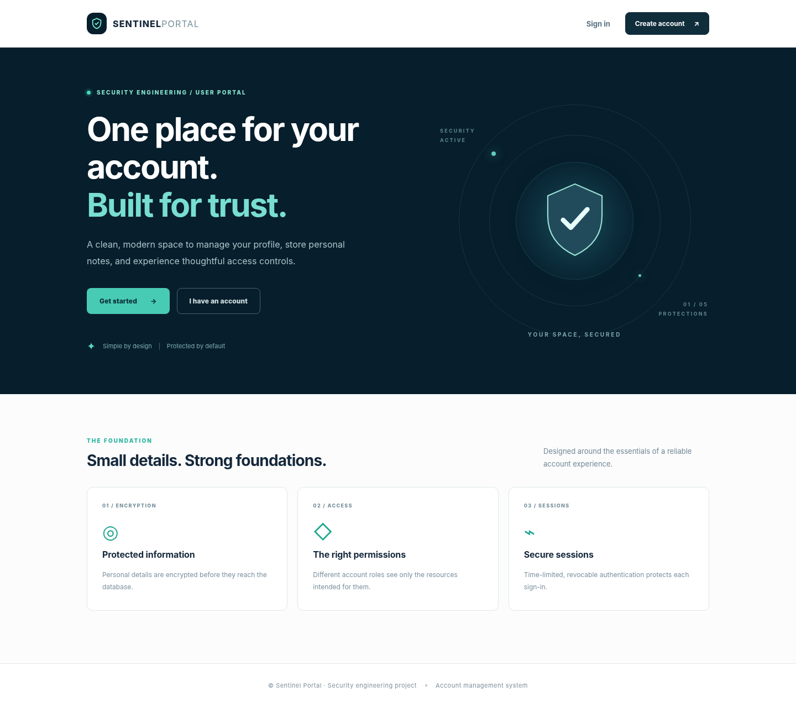

# RiskCrest

**A secure web application with a local before/after vulnerability laboratory.**

RiskCrest is a simple account-management application created for the project **"Building a Secure Web Application - Detection and Mitigation of Security Vulnerabilities."** It demonstrates account registration, sign-in, a personalized dashboard, encrypted contact details, private notes, role-based administration, and logout that immediately invalidates the authentication session.

The repository has two deliberately distinct applications:

| Application | Purpose | Address | Database |
|---|---|---|---|
| **Secure application** (`app/`) | The final, fixed implementation | `https://127.0.0.1:5443` | `instance/secure.sqlite3` |
| **Vulnerable lab** (`lab/`) | The *before* implementation, for controlled testing **only** | `http://127.0.0.1:5001` | `instance/lab.sqlite3` |

**Do not deploy the vulnerable lab or use real credentials in it.** Both runners bind to `127.0.0.1`, so they are accessible only on the computer running them. The lab also rejects non-loopback request clients.



## 1. Requirements

- Python **3.11 or newer**
- pip and a web browser
- Windows, macOS, or Linux
- Internet access for installing Python packages on first setup

The secure implementation uses FastAPI, SQLite, Jinja2, Argon2id (`argon2-cffi`), Bleach for HTML sanitization, and `cryptography` Fernet for authenticated encryption. Automated tests use `pytest` and FastAPI's test client.

## 2. Quick start: secure app

Run these commands from the root folder containing `README.md`.

### Windows (PowerShell)

```powershell
py -m venv .venv
.\.venv\Scripts\Activate.ps1
python -m pip install -r requirements.txt
python scripts/create_dev_cert.py
python run_secure.py
```

### macOS / Linux

```bash
python3 -m venv .venv
source .venv/bin/activate
python -m pip install -r requirements.txt
python scripts/create_dev_cert.py
python run_secure.py
```

Open **https://127.0.0.1:5443**. A browser security warning is expected because the generated certificate is **self-signed and valid for local demonstration only**. In a local test environment, choose the browser's option to continue. Never treat a self-signed certificate as equivalent to a publicly trusted production certificate.

Create an ordinary account through **Create account**, then sign in. An administrator must be provisioned separately (see below).

**Password policy:** at least 8 characters; at least one uppercase letter, lowercase letter, digit, and special character. The registration form displays these requirements, and the server enforces them.

### Create an administrator

In another terminal with the virtual environment active:

```bash
python -m scripts.create_admin --username portal_admin
```

Enter a unique strong password when prompted; the password is **not** passed as a shell argument. You can then sign in with that administrator account and open `/admin`. Ordinary registration never grants the administrator role.

**Important:** The encrypted database fields depend on the locally generated keys in `instance/keys/`. These keys survive application restarts, but should never be committed, copied into a public repository, or deleted while encrypted data must remain readable. `.gitignore` excludes the database, keys, certificates, and environment secrets.

## 3. Run the vulnerable *before* lab

In a separate terminal:

```bash
python run_lab.py
```

Open **http://127.0.0.1:5001**. The isolated lab contains *fictional* sample accounts:

| Username | Password | Role |
|---|---|---|
| `lab_user` | `LabPass1!` | Standard user |
| `lab_admin` | `LabAdmin1!` | Administrator |

This app deliberately contains weak MD5 password hashes, SQL string interpolation, unsafe HTML rendering, missing role checks, and no encrypted email or HTTPS. They exist only to compare vulnerable behavior with the mitigations in `app/main.py` and `app/security.py`.

### Controlled manual demonstrations (local lab only)

| Vulnerability | In the lab | In the secured app |
|---|---|---|
| SQL injection, login | In **Username**, enter `lab_user' --` and any wrong password; sign-in succeeds. | Try the same input at `https://127.0.0.1:5443/login`; sign-in is rejected. |
| SQL injection, registration | Enter `injected_admin', 'injectedhash', 'admin') --` as the lab username; the resulting record has role `admin`. | The same registration string is rejected by validation; parameterized queries prevent changing SQL structure. |
| Weak password storage | Inspect `instance/lab.sqlite3` → `users.password_md5`; values are 32-character MD5 digests. | Inspect `instance/secure.sqlite3` → `users.password_hash`; values use the salted `$argon2id$` format. |
| Stored XSS | Sign into the lab, save a note containing ``; the element is emitted unescaped on the dashboard. | Save the same note in the secure app; HTML is stripped before storage and output is escaped. |
| Broken access control | Sign in as `lab_user`, visit `/admin`; the directory is visible. | Sign in as any ordinary user, visit `/admin`; receive **403 Access denied**. |
| Data / transport encryption | The lab uses plain HTTP and does not encrypt personal contact fields. | The secure app uses TLS for local HTTPS, encrypted email and session tokens, and protected cookies. |

All examples must stay inside this loopback-only project lab. They are **not** intended for testing systems owned by anyone else.

## 4. Automated security tests

From the project root:

```bash
pytest -q
```

**Verified local result on 18 November 2026:** `37 passed`.

The test suite creates temporary databases and separate keys, so it does not change normal application data. Security cases include SQL injection in both forms, MD5-versus-Argon2id storage, password complexity, HTML sanitization, RBAC, encryption at rest, cookie flags, session revocation, browser cache restrictions, CSRF checks, HTTPS redirects, and a self-signed certificate with the expected subject alternative name.

See `docs/SECURITY_REPORT.pdf` for the testing table, access-control matrix, explanations, and a discussion of implementation challenges. The editable report source is `docs/SECURITY_REPORT.md`. To regenerate the PDF, install `requirements-report.txt` and run `python scripts/build_report.py`.

## 5. Application structure

```text
RiskCrest/
├── app/
│   ├── main.py                 # Secure routes, validation, RBAC, sessions, HTTPS
│   ├── db.py                   # SQLite schema, transactions, parameterized access
│   ├── security.py             # Argon2id, Fernet, CSRF, content sanitization
│   ├── templates/              # Jinja2 pages and accessible forms
│   └── static/                 # Responsive CSS, small local JavaScript
├── lab/
│   └── main.py                 # Isolated intentionally vulnerable baseline
├── scripts/
│   ├── create_admin.py         # Interactive administrator provisioning
│   └── create_dev_cert.py      # Local self-signed TLS certificate generation
├── tests/
│   ├── test_secure.py          # Fixed-state tests
│   └── test_lab.py             # Reproducible before-state tests
├── docs/
│   ├── SECURITY_REPORT.pdf     # Report for submission
│   ├── SECURITY_REPORT.md      # Editable text version of report
│   └── screenshots/            # Actual rendered application views
├── instance/                   # Runtime databases/keys, excluded from Git
├── run_secure.py
├── run_lab.py
├── requirements.txt
├── .gitignore
└── README.md
```

## 6. Main security decisions

- **Parameterized queries:** Secure account creation, login, data updates, and notes bind user-supplied values using SQLite `?` parameters instead of building SQL text from input.
- **Password hashing:** Argon2id with 19 MiB of memory, two iterations, one lane, and a unique random salt per hash. Passwords are never stored as plaintext or reversible encryption.
- **XSS defenses:** Bleach strips HTML from note content; Jinja2 autoescaping treats stored content as text. The secure application never uses `|safe` for user-authored notes.
- **RBAC:** The server loads the authenticated account's role from the database for each request. `/admin` allows administrators only; creating a public account always assigns `user`.
- **Encryption:** Fernet protects optional email addresses at rest and encrypts the opaque authentication ticket placed in a cookie. Only a SHA-256 digest of the raw ticket is stored in the server-side session table.
- **HTTPS:** `run_secure.py` uses TLS with a locally generated certificate; HTTP is redirected to HTTPS. Cookie flags include `Secure`, `HttpOnly`, and `SameSite=Lax`.
- **Logout:** The active session digest is deleted from the database, the browser cookie is deleted, and private responses use `Cache-Control: no-store` to prevent stale content after logout.
- **Additional controls:** CSRF signatures, 30-minute expiry, input validation, restrictive content security policy, and anti-clickjacking/anti-sniffing headers.

## 7. Running and inspecting evidence

Screenshots are in `docs/screenshots/`:

- `01-home.png` - home page
- `02-registration.png` - registration with password rules
- `03-login.png` - sign-in interface
- `04-dashboard.png` - signed-in account and notes
- `05-administration.png` - administrator-only account list
- `06-mobile-home.png` - responsive mobile layout

For a live demonstration: show the secure registration/login flow; demonstrate a standard user gets 403 from `/admin`; save an XSS-style note safely; show encrypted data in SQLite; log out and revisit `/dashboard`; then start the lab and repeat the corresponding unsafe examples. Finish by running `pytest -q`.

## 8. GitHub and project updates

This repository is the source of the RiskCrest application. To get the latest changes into an existing VS Code checkout, run `git pull origin main` from the project root, then run `python -m pytest -q`.

The application runs **locally**; publishing its code to GitHub does not host the website. Never publish databases, credentials, private certificates, or runtime encryption keys. The vulnerable comparison app must never be deployed to a public server.

## 9. Scope and references

This is a course-scale application and local security test bench, **not a production deployment**. For a real deployment, use a publicly trusted TLS certificate, production-grade key management and backup/rotation, centralized audit logging, rate limiting, and security review. The vulnerable lab must never be deployed.

Library documentation and security design references:

- [FastAPI documentation](https://fastapi.tiangolo.com/)
- [Argon2-cffi documentation](https://argon2-cffi.readthedocs.io/)
- [Cryptography Fernet](https://cryptography.io/en/stable/fernet/)
- [OWASP SQL Injection Prevention](https://cheatsheetseries.owasp.org/cheatsheets/SQL_Injection_Prevention_Cheat_Sheet.html)
- [OWASP Password Storage](https://cheatsheetseries.owasp.org/cheatsheets/Password_Storage_Cheat_Sheet.html)
- [OWASP Cross-Site Scripting Prevention](https://cheatsheetseries.owasp.org/cheatsheets/Cross_Site_Scripting_Prevention_Cheat_Sheet.html)
